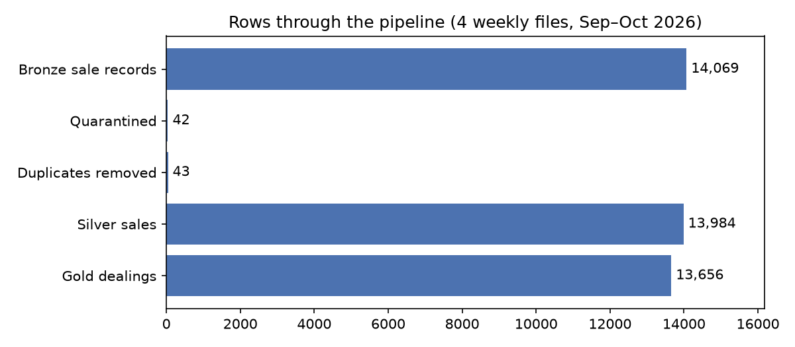
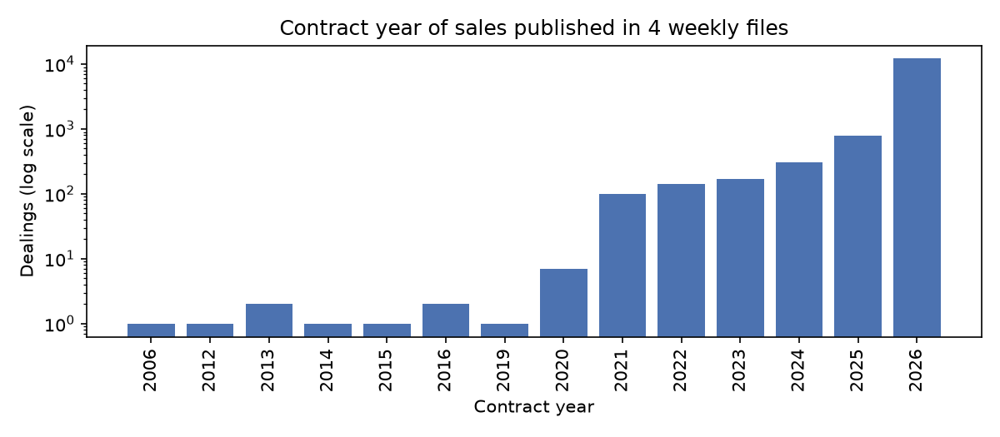

# NSW Property Sales Pipeline

> Work in progress. A batch data pipeline that ingests weekly NSW property sales data, cleans and quality-checks it, and produces suburb-level quarterly price and volume metrics.

## Problem
How do median house prices and sales volumes change by suburb and quarter across NSW?

The NSW Valuer General publishes sales as weekly raw files, so a one-off notebook is not enough:
- **New files every week.** The pipeline processes only new or changed files instead of
  starting from scratch.
- **Late-arriving sales.** About 12% of each week's sales were contracted in earlier years,
  so past quarters must be recomputed when new data arrives.
- **Messy source data.** Records repeat across weeks, some have missing or impossible values,
  and multi-property sales repeat the total price. These need consistent, tested rules.
- **Reproducible.** Re-running gives the same result, and every run reconciles row counts.

## Data
- Source: NSW Valuer General, [Bulk Property Sales Information](https://valuation.property.nsw.gov.au/embed/propertySalesInformation) (weekly `.DAT` files per Local Government Area, 2001 onwards; yearly files 1990–2001).
- Licence: [CC BY-NC-ND 4.0](https://creativecommons.org/licenses/by-nc-nd/4.0/), as stated on the official page (checked 2026-10-26). Used here for non-commercial, educational purposes only.
- **No raw or processed data is stored in this repository.** Run the pipeline locally to reproduce results.
- © State of New South Wales through the NSW Valuer General. The Valuer General does not guarantee the completeness or accuracy of the data.

## Architecture
```
raw (weekly zips) ──► bronze ──► silver ──► gold (coming soon)
```
| Layer | What happens | Output |
| --- | --- | --- |
| Raw | Weekly zips downloaded from NSW Valuer General | `data/raw/*.zip` |
| Bronze | Parse `.DAT` files (record types A/B/C/D/Z), keep all values as strings, add `source_file`, `ingested_at`. Incremental: a manifest of file name + SHA-256 skips files already loaded | Parquet per record type |
| Silver | Cast types, convert hectares to m², join legal descriptions (C) and buyer/seller counts (D), apply quality rules, deduplicate on (dealing_number, property_id, strata_lot_number) | Clean sales + quarantine |
| Gold | Suburb × quarter volume and median price | Coming soon |

Bronze uses pandas (small files, one at a time). Silver and gold use PySpark.

## Project structure

```
nsw-property-pipeline/
├── src/pipeline/
│   ├── parse.py          # Parse PSI .DAT files into one table per record type
│   ├── bronze.py         # Write bronze Parquet, manifest for incremental loads
│   ├── run_bronze.py     # Entry point: unzip weekly files and ingest to bronze
│   ├── spark.py          # Local Spark session settings
│   ├── silver.py         # Typing, enrichment, quality rules, deduplication
│   └── run_silver.py     # Entry point: build silver sales and quarantine
├── tests/                # pytest suite (made-up fixture data only)
├── notebooks/            # Phase 1 data exploration
├── docs/
│   ├── data-notes.md     # Source file format and data problems found
│   ├── decisions.md      # Design decisions and trade-offs
│   └── problems-log.md   # Issues hit during development and fixes
└── data/                 # Local only, not in Git (licence: CC BY-NC-ND 4.0)
    ├── raw/              # Weekly zips from NSW Valuer General
    ├── bronze/           # Parsed records as Parquet, all strings
    └── silver/           # Typed, cleaned, deduplicated sales + quarantine
```

## How to run
Requires conda (Python 3.11 and Java 17 for PySpark 3.5).

```bash
conda create -n nsw-pipeline -c conda-forge python=3.11 openjdk=17
conda activate nsw-pipeline
pip install -r requirements.txt
pytest -q
```

1. Download weekly zips in a browser from
   `https://www.valuergeneral.nsw.gov.au/__psi/weekly/YYYYMMDD.zip` (YYYYMMDD = a Monday)
   and put them in `data/raw/`.
2. Run the whole pipeline:

```bash
PYTHONPATH=src python -m pipeline.run
```

This runs bronze → silver → gold and writes a run report to `data/reports/` with row counts,
quarantine reasons and the quarters refreshed. Re-running is safe: unchanged files are skipped
and gold only recomputes quarters touched by new data. Each layer can also be run on its own
(`pipeline.run_bronze`, `pipeline.run_silver`, `pipeline.run_gold`).

## Data quality
Rows that break a hard rule go to a quarantine table with the list of rules they failed,
instead of being deleted. Every run must reconcile: bronze rows = silver + quarantine + duplicates.

Result on 4 weeks (2026-09-28 to 2026-10-19):

| Step | Rows |
| --- | --- |
| Bronze sales records | 14,069 |
| Quarantined (37 missing property_id, 3 missing contract date, 2 contract before 2001) | 42 |
| Duplicates removed (35 repeated across weeks, 8 written twice in one file) | 43 |
| Silver sales | 13,984 |

The parser also checks every file's row counts against its Z trailer record.

## Results
Run on 4 weekly files (28 Sep – 19 Oct 2026).



Every run reconciles: bronze records = silver sales + quarantined + duplicates, and gold
sales counts add up to the number of dealings in silver.



About 12% of sales published in these weeks were contracted in earlier years, back to 2006.
This is why gold recomputes every quarter a new file touches, not only the current one.

Suburb-level price results are not published here because of the data licence
(CC BY-NC-ND 4.0).

## Design decisions
See [docs/decisions.md](docs/decisions.md).

## Problems I hit and how I solved them
See [docs/problems-log.md](docs/problems-log.md).

## Limitations and next steps
- Only 4 weeks of data so far; deduplication and late-arrival rules need checking on more history.
- Downloads are manual because the source blocks scripted access.
- Silver is fully rebuilt each run; fine at this size, not for many years of data.
- Next: gold layer, quality report per run, scheduling.
